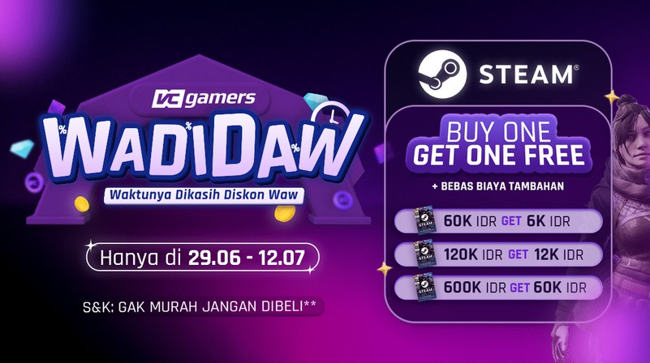
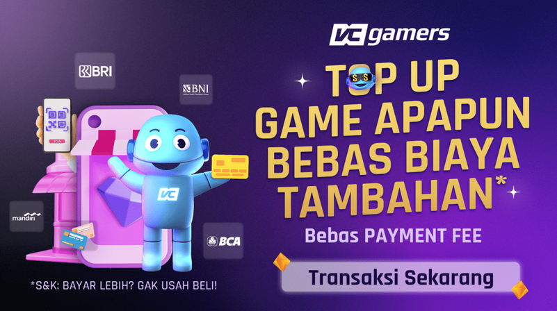
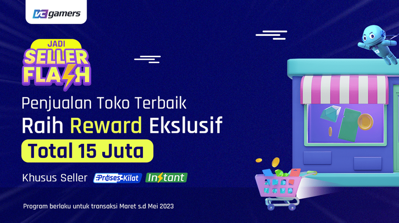
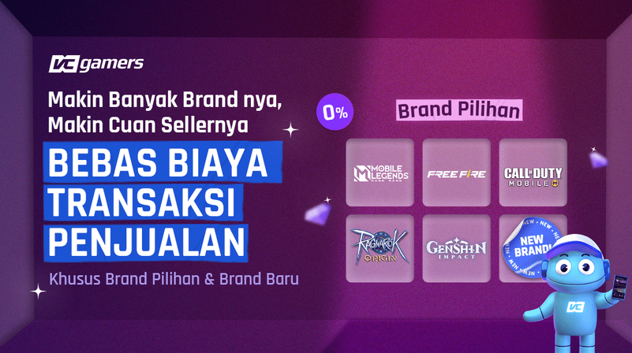

# Campaign Operations

This section documents selected campaign planning and execution work from my previous professional experience.

The work covered sales and promotional campaigns designed to drive transactions, customer engagement, and platform activity.

The available portfolio evidence includes campaign objectives, promotional creatives, execution examples, and documented results.

## Overview

My campaign operations work involved planning, coordinating, executing, and monitoring sales and promotional campaigns.

Key activities included:

- Campaign planning and execution
- Sales and promotional initiatives
- Promotional offer communication
- Customer engagement activities
- Coordination with marketing and operational activities
- Campaign performance monitoring

The original portfolio describes this work as designing, planning, and executing sales and promotional campaigns to drive sales to the platform.

## Selected Campaigns

The campaigns below are selected from the available portfolio documentation and visual evidence.

### 1. Steam WADIDAW Campaign

A promotional campaign focused on Steam-related products and transactions.

The campaign documentation includes promotional creative and a documented result of **10× Gross Transaction Value**.



**Focus areas:**

- Sales promotion
- Product campaign
- Transaction growth
- Customer communication

**Documented result:**

- 10× Gross Transaction Value

### 2. 11.11 Nolep Campaign

A promotional campaign associated with the 11.11 shopping period.

The available portfolio documentation reports a **1,143% ROAS** for the campaign.


**Focus areas:**

- Promotional campaign
- Sales activation
- Customer acquisition and conversion
- Campaign performance

**Documented result:**

- 1,143% ROAS

### 3. Santa's Gift Campaign

A customer engagement and promotional campaign designed to increase activity around the platform.

The portfolio documents a **125% increase in social media impressions** and an increase in website visits associated with the campaign.


**Focus areas:**

- Customer engagement
- Social media campaign
- Promotional communication
- Website traffic

**Documented results:**

- 125% increase in social media impressions
- Increased website visits

## Additional Campaign Work

The available campaign materials also include promotional activities covering different products, offers, and sales initiatives.

### Merdeka Game Campaign


### Top Up Gamepass Campaign



### Seller Flash Campaign



### Pocong Harga Campaign


### Bebas Biaya Penjualan Campaign



These additional campaign assets provide supporting evidence of the range of promotional activities documented in the original portfolio.

## Campaign Workflow

The campaign work can be broadly described as:

```text
Campaign Objective
       ↓
Campaign Planning
       ↓
Offer / Promotion Design
       ↓
Campaign Communication
       ↓
Campaign Execution
       ↓
Customer / User Engagement
       ↓
Performance Monitoring
```

## Performance Monitoring

Campaign performance was documented through different outcome indicators depending on the campaign objective.

Available documented indicators include:

- Gross Transaction Value
- Return on Ad Spend (ROAS)
- Social media impressions
- Website visits

These indicators demonstrate different aspects of campaign performance, from transaction activity and advertising efficiency to audience engagement and traffic generation.

## Relevance to Merchant Operations

Campaign operations experience provides a foundation for supporting merchant promotional initiatives and marketplace campaigns.

Relevant capabilities include:

- Understanding promotional objectives and mechanics.
- Coordinating campaign communication and execution.
- Supporting product and sales promotions.
- Understanding how promotional activities relate to transaction performance.
- Monitoring campaign outcomes through relevant performance indicators.

These capabilities are applicable when coordinating merchant promotions, voucher campaigns, special offers, and other marketplace initiatives.

## Notes on Documentation

This section represents campaign work from previous professional experience.

The original work was completed several years ago, and not all underlying campaign documentation is still available.

Therefore, this repository only documents campaign details and results supported by the available portfolio material and professional records.

Where additional details are not available, they are intentionally not reconstructed as original campaign documentation.
