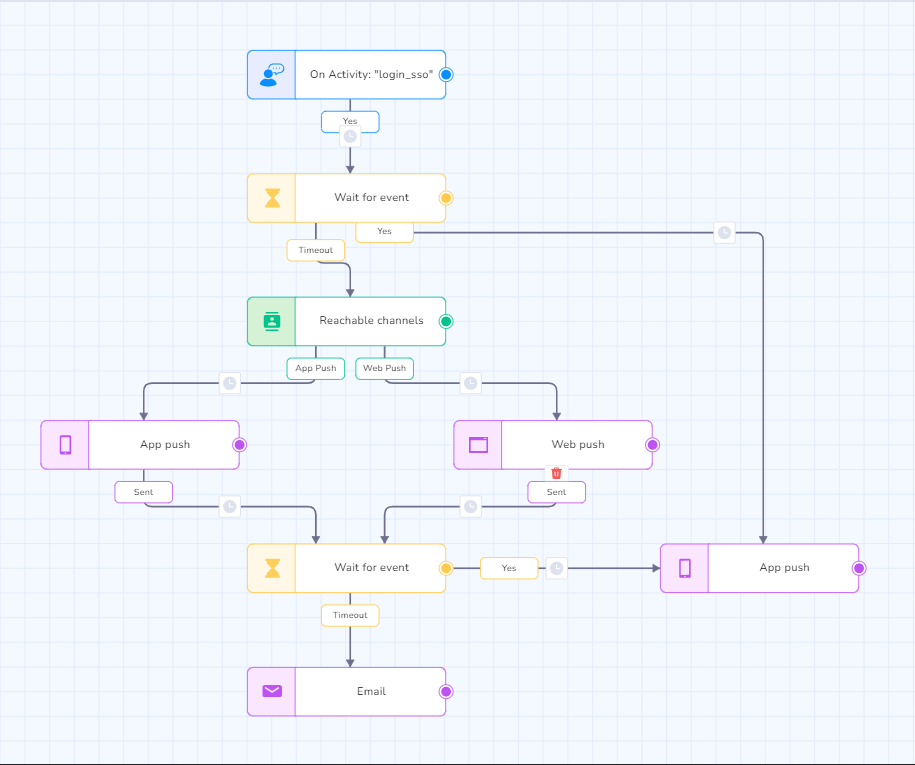
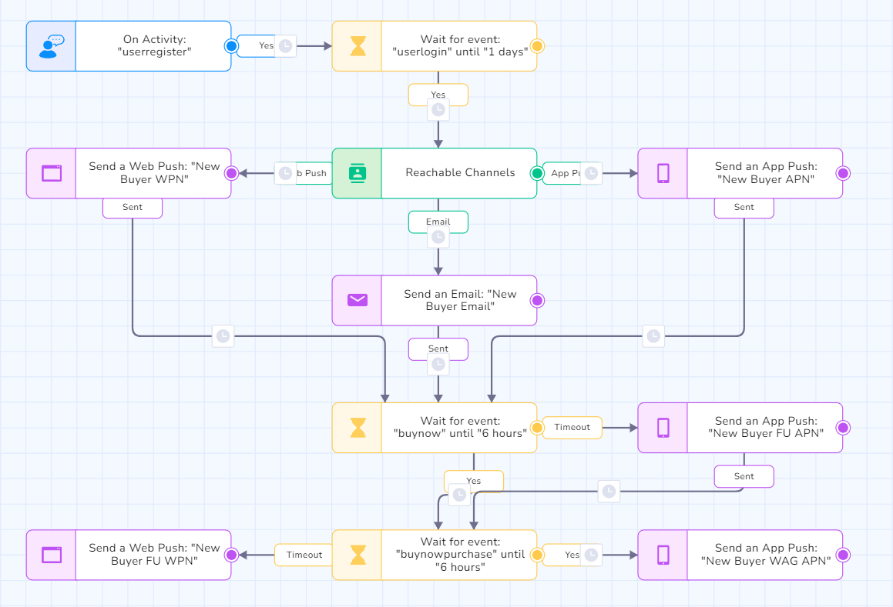
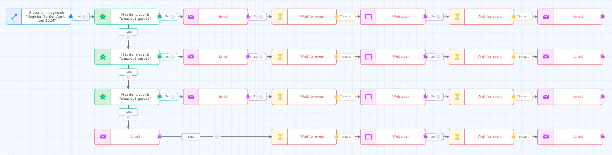

# CRM

This section documents selected professional work involving CRM management, customer lifecycle campaigns, user segmentation, and CRM automation.

The work documented here comes from my previous professional experience and is based on the available portfolio evidence from that period.

## Overview

My CRM-related work focused on managing customer lifecycle activities and using CRM platforms to support onboarding, engagement, retention, and conversion.

Responsibilities included working with customer segments, managing lifecycle campaigns, designing automated communication workflows, and coordinating CRM activities with marketing and operations teams.

## Areas of Work

### CRM Lifecycle Management

Managed customer lifecycle campaigns and communication flows across different stages of the customer journey.

Activities included:

- Customer lifecycle campaign management
- User segmentation
- CRM automation
- Onboarding communication
- Customer engagement
- Retention activities
- Conversion-focused communication

### User Segmentation

Worked with customer and user segments to support more relevant communication and lifecycle activities.

Segmentation helped determine how users should be engaged based on their position within the customer journey.

### CRM Campaign & Automation

Designed and managed automated customer communication workflows using CRM platforms.

These workflows supported activities such as:

- User onboarding
- Customer activation
- Engagement
- Retention
- Transaction-related communication
- Follow-up communication

The available portfolio evidence includes visual workflow examples showing automated communication across multiple channels.

## Selected Professional Work

### 1. CRM Lifecycle Management

Managed customer lifecycle campaigns, user segmentation, and CRM automation to support onboarding, engagement, retention, and conversion activities.

The work involved coordinating CRM activities with broader marketing and operational initiatives.

**Focus areas:**

- Lifecycle management
- Customer segmentation
- CRM automation
- Campaign management
- Customer engagement
- Retention
- Conversion

**Documented tools:**

- Netcore / WebEngage

### 2. User Engagement & Onboarding Workflow

Designed and executed onboarding and retention workflows using multiple customer communication channels.

The documented workflow includes automated communication using:

- Email
- Push notifications
- In-app messaging
- Web push

The workflow was designed to support customer activation and help users progress through the early stages of their journey.

### 3. Customer Journey & Transaction Engagement

Developed CRM communication flows to engage users at different points within the transaction journey.

One documented workflow focused on engaging users who had entered the transaction flow but had not successfully completed the intended action.

The work used automated communication and follow-up flows to support purchase completion.

### 4. Lifecycle Automation Workflow

Worked with automated CRM workflows to manage customer communication throughout the lifecycle.

The documented workflow demonstrates how customer engagement activities could be structured through automated lifecycle stages.

## Tools

Tools documented in my previous portfolio include:

### CRM & Customer Engagement

- Netcore / WebEngage
- Braze
- Qontak
- Mailjet
- n8n

### Communication Channels

- Email
- Push notifications
- In-app messaging
- Web push
- WhatsApp-based communication

> Tool usage may differ between projects. Specific tools will only be attributed to a case study where the available documentation supports it.

## Evidence

The original portfolio contains visual evidence of CRM workflows and customer engagement activities.

Available evidence includes:

- CRM workflow diagrams
- Automated customer journey flows
- User engagement workflows
- Campaign-related CRM activities
- Screenshots of communication flows

The extracted visual assets used in this repository are stored centrally in the root `assets/` directory.

## Relevance to Merchant Operations

CRM experience provides a foundation for supporting merchant-facing engagement initiatives and marketplace campaigns.

Relevant capabilities include:

- Customer segmentation for targeted promotions.
- Campaign communication planning.
- Automated customer engagement.
- Lifecycle-based communication.
- Coordination between marketing and operational activities.

These capabilities can support merchant promotional campaigns, voucher distribution initiatives, and customer engagement programs.

## Notes on Documentation

This section represents professional work from previous employment.

The original work was completed several years ago, and not all underlying company documentation is still available.

Therefore, this repository only documents details that can be supported by the available portfolio material and professional records.

Where additional details are not available, they are intentionally not reconstructed as original company documentation.
