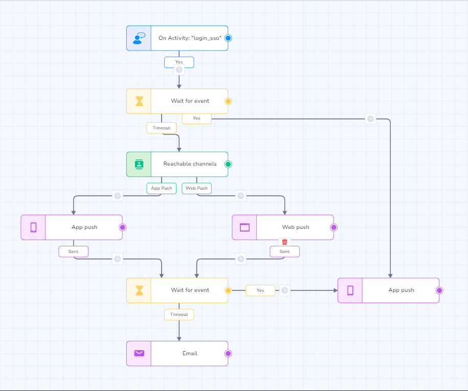
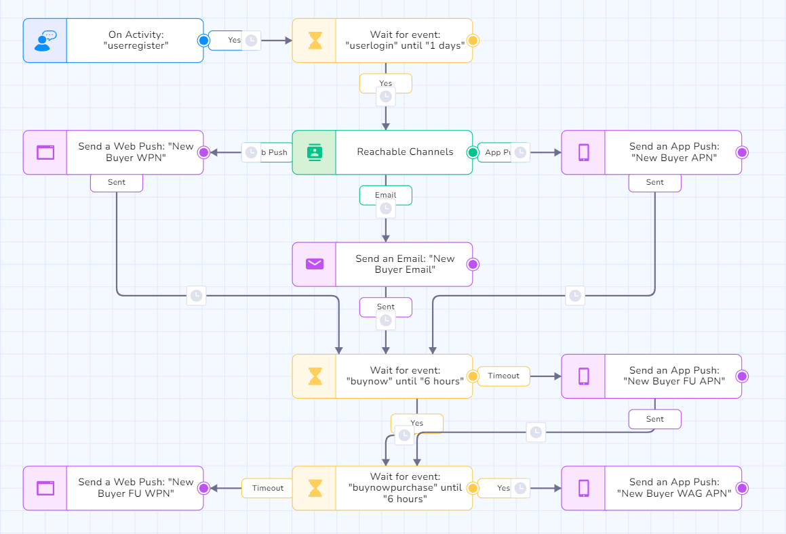
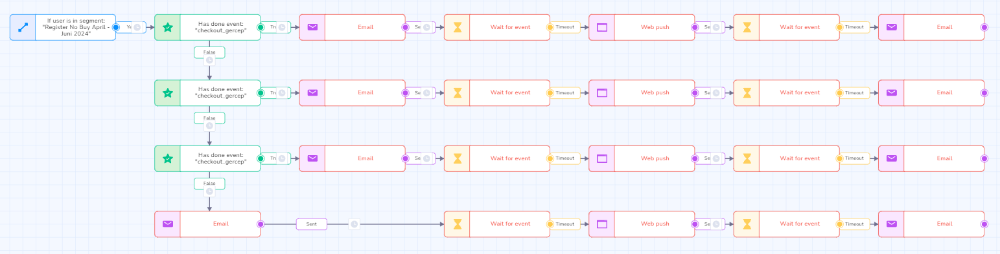

# Customer Engagement

This section documents selected professional work involving customer onboarding, user activation, CRM communication, transaction journey engagement, and purchase lifecycle activities.

The work documented here comes from my previous professional experience and is based on the available portfolio evidence from that period.

## Overview

My customer engagement work focused on guiding users through different stages of their customer journey using structured communication workflows.

The activities covered the journey from user registration and onboarding to first purchase, transaction engagement, and subsequent lifecycle communication.

These workflows used multiple communication channels to deliver relevant messages and encourage users to complete their intended actions.

## Areas of Work

### User Onboarding & Activation

Developed and managed communication workflows for newly registered users.

The objective was to guide users through the initial stages of their customer journey and encourage their first meaningful interaction with the platform.

Key activities included:

- User onboarding
- Activation communication
- First-purchase engagement
- Customer lifecycle communication
- Multi-channel engagement

### Transaction Journey Engagement

Worked on communication workflows for users entering the transaction process.

These workflows supported user engagement and purchase completion through relevant communication and follow-up activities.

Key activities included:

- Transaction journey communication
- Customer follow-up
- Purchase completion support
- Lifecycle automation

### Purchase Journey & Retention

Worked with customer communication across different stages of the purchase journey.

The workflows supported engagement beyond initial registration and purchase, with a focus on customer lifecycle, retention, and conversion.

## Selected Professional Work

### 1. User Onboarding & Activation

Designed and executed customer engagement workflows for users who had registered on the platform.

The workflows used multiple communication channels to guide users through the early stages of their customer journey.

**Documented channels:**

- Email
- Push notifications
- In-app messaging
- Web push



### 2. Registered User → First Purchase

Worked on customer engagement activities intended to move registered users toward their first purchase.

The documented workflow focused on communication and follow-up during the period between registration and the first purchase.

**Focus areas:**

- User activation
- First-purchase engagement
- Customer lifecycle
- Automated communication

### 3. Transaction Journey Engagement

Developed engagement flows for users who entered the transaction journey.

The workflow used customer communication to follow up with users during the transaction process and support purchase completion.



**Focus areas:**

- Transaction journey
- Customer engagement
- Follow-up communication
- Purchase completion

### 4. Purchase Journey Engagement

Worked with customer journey communication around purchase-related activities.

The available portfolio material includes documented customer journey examples showing how communication could be structured across different stages of the purchase process.



**Focus areas:**

- Purchase journey
- Customer lifecycle
- Engagement
- Retention
- Conversion

## Communication Channels

The available portfolio evidence shows customer engagement activities involving multiple communication channels, including:

- Email
- Push notifications
- In-app messaging
- Web push
- WhatsApp-based communication

The specific channels used depended on the workflow and campaign.

## Engagement Workflow

The documented customer engagement work can be broadly represented as:

```text
User Registration
       ↓
Customer Segmentation
       ↓
Onboarding Communication
       ↓
User Activation
       ↓
First Purchase
       ↓
Transaction Journey Engagement
       ↓
Follow-up / Next Lifecycle Stage
       ↓
Retention & Continued Engagement
```

## Relevant Capabilities

This experience demonstrates practical capabilities in:

- Customer onboarding and activation.
- CRM communication workflow execution.
- Customer lifecycle engagement.
- Multi-channel communication.
- Transaction journey engagement.
- Purchase completion support.
- Retention and conversion-oriented communication.

## Relevance to Merchant Operations

Although this experience focuses on customer lifecycle engagement rather than direct merchant account operations, it provides relevant capabilities for understanding user journeys and communication across digital platforms.

This understanding is useful when supporting merchants with customer-facing promotions, voucher campaigns, transaction-related communication, and initiatives intended to improve customer engagement.

## Scope and Context

This section documents customer engagement and CRM-related work from previous professional experience.

It focuses on the workflows and communication activities supported by the available portfolio evidence. It does not claim ownership of the entire CRM platform or responsibility for technical system administration.
