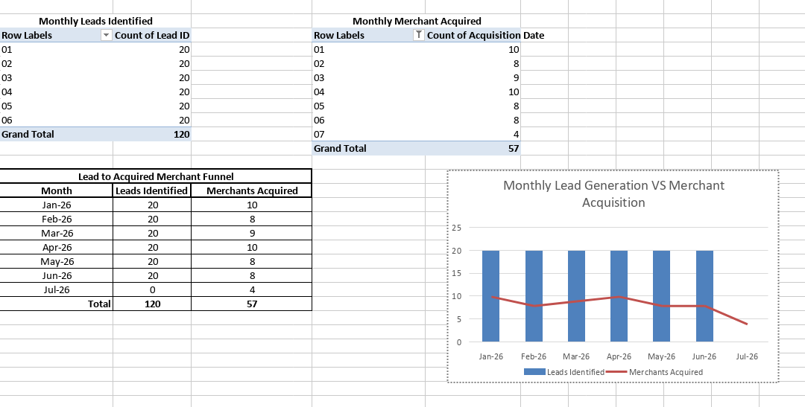
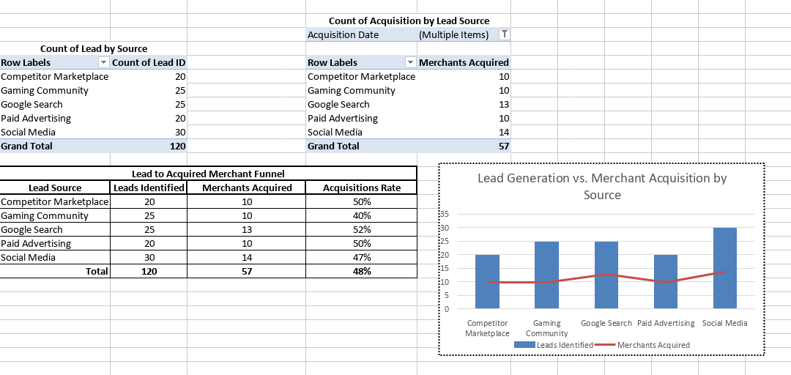
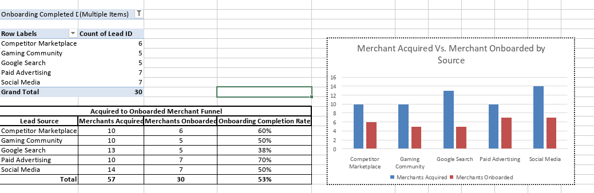
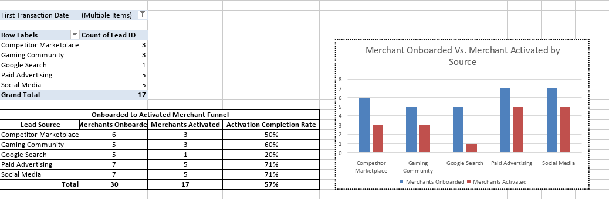
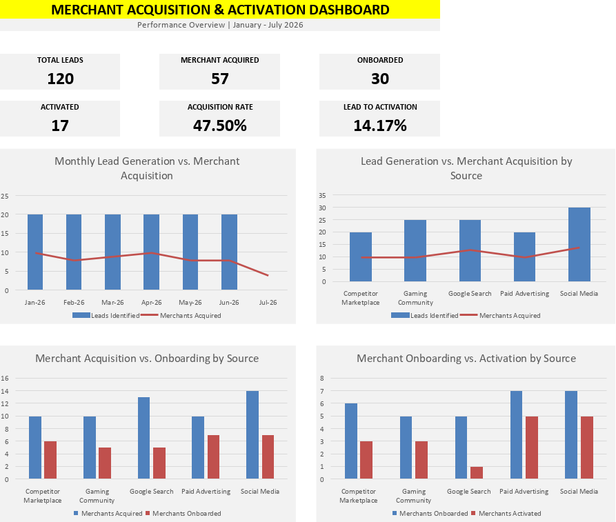

# Merchant Acquisition & Activation Performance Analysis

## Project Overview

This project analyzes merchant acquisition and activation performance across five different lead sources using a synthetic dataset of 120 prospective merchants.

The objective is to evaluate how effectively different acquisition channels generate leads, convert prospects into acquired merchants, complete onboarding, and eventually generate their first transaction.

The analysis was conducted using Microsoft Excel, utilizing Excel Tables, PivotTables, formulas, and data visualizations.

> **Disclaimer:** All data used in this project is synthetic and created exclusively for portfolio and analytical demonstration purposes. It does not represent actual company or business records.

## Business Context

Merchant acquisition is an important operational activity for marketplaces and digital platforms.

Businesses can identify and acquire prospective merchants through various channels, such as:

- Social media sellers
- Google Search and top-up websites
- Paid advertising campaigns
- Gaming communities
- Competitor marketplaces

However, acquiring a merchant does not necessarily mean that the merchant will complete onboarding or start transacting.

This analysis evaluates the merchant journey across four stages:

1. Lead Generation
2. Merchant Acquisition
3. Onboarding Completion
4. Merchant Activation

The objective is to identify differences in channel performance and understand where potential conversion bottlenecks occur.

## Project Objectives

1. Analyze monthly lead generation and merchant acquisition trends.
2. Compare lead volume and acquisition conversion rates across different sources.
3. Evaluate merchant onboarding completion performance.
4. Measure merchant activation through first transactions.
5. Identify potential differences in conversion performance across acquisition channels.

## Dataset Overview

The dataset contains 120 synthetic merchant leads identified between January and June 2026.

### Key Dataset Fields

| Field | Description |
|---|---|
| Lead ID | Unique identifier for each lead |
| Merchant Name | Synthetic merchant name |
| Lead Identified Date | Date the lead was identified |
| Lead Source | Acquisition channel |
| Source Detail | More specific source information |
| City | Merchant location |
| Product Category | Merchant product category |
| Previous Marketplace Experience | Whether the merchant has previous marketplace experience |
| First Contact Date | Date of first contact |
| Contact Status | Contact progress |
| Acquisition Date | Date the merchant was acquired |
| Onboarding Status | Onboarding progress |
| Onboarding Completed Date | Date onboarding was completed |
| Merchant Status | Current merchant status |
| First Transaction Date | Date of the first transaction |
| Activation Status | Whether the merchant has completed a first transaction |

## Analysis & Visualizations

This case study contains four visualizations covering the merchant acquisition and activation funnel.

### 1. Monthly Lead Generation vs. Merchant Acquisition

**Business Question:** Are monthly lead volumes translating into successful merchant acquisitions?

This visualization compares:

- Monthly leads identified.
- Monthly merchants acquired.



**Monthly Performance**

| Month | Leads Identified | Merchants Acquired |
|---|---:|---:|
| Jan 2026 | 20 | 10 |
| Feb 2026 | 20 | 8 |
| Mar 2026 | 20 | 9 |
| Apr 2026 | 20 | 10 |
| May 2026 | 20 | 8 |
| Jun 2026 | 20 | 8 |
| Jul 2026 | 0 | 4 |
| **Total** | **120** | **57** |

**Key Observations**

- Lead generation remained consistent at 20 leads per month from January to June.
- Monthly merchant acquisitions ranged from 8 to 10 during January–June.
- Four additional merchants were acquired in July from leads identified in previous months.

**Business Interpretation**

Consistent lead generation does not necessarily result in acquisitions within the same month.

Lead identification and merchant acquisition are measured using different date fields. Therefore, acquisition activity may occur in a different month from the original lead identification.

### 2. Lead Generation vs. Merchant Acquisition by Source

**Business Question:** Which acquisition channels generate the highest number of acquired merchants?

This visualization compares lead volume and acquired merchants across five acquisition sources.



**Acquisition Performance**

| Lead Source | Leads Identified | Merchants Acquired | Acquisition Rate |
|---|---:|---:|---:|
| Competitor Marketplace | 20 | 10 | 50.0% |
| Gaming Community | 25 | 10 | 40.0% |
| Google Search | 25 | 13 | 52.0% |
| Paid Advertising | 20 | 10 | 50.0% |
| Social Media | 30 | 14 | 46.7% |
| **Total** | **120** | **57** | **47.5%** |

**Key Observations**

- Social Media generated the highest lead volume, with 30 leads and 14 acquired merchants.
- Google Search achieved the highest acquisition rate at 52%.
- Competitor Marketplace and Paid Advertising both achieved a 50% acquisition rate.
- Gaming Community recorded the lowest acquisition rate at 40%.

**Hypothesis Evaluation**

An initial hypothesis suggested that merchants sourced from competitor marketplaces might be easier to acquire because they are already familiar with marketplace workflows.

However, Google Search achieved a slightly higher acquisition rate (52%) compared to Competitor Marketplace (50%).

Therefore, the initial hypothesis is not supported by the current synthetic dataset.

Further analysis would be required to understand whether previous marketplace experience influences acquisition outcomes.

### 3. Merchant Acquisition vs. Onboarding by Source

**Business Question:** How effectively do acquired merchants complete the onboarding process?

This visualization compares acquired merchants with merchants who successfully completed onboarding.



**Onboarding Performance**

| Lead Source | Merchants Acquired | Merchants Onboarded | Onboarding Completion Rate |
|---|---:|---:|---:|
| Competitor Marketplace | 10 | 6 | 60.0% |
| Gaming Community | 10 | 5 | 50.0% |
| Google Search | 13 | 5 | 38.5% |
| Paid Advertising | 10 | 7 | 70.0% |
| Social Media | 14 | 7 | 50.0% |
| **Total** | **57** | **30** | **52.6%** |

**Key Observations**

- Paid Advertising achieved the highest onboarding completion rate at 70%.
- Competitor Marketplace achieved a 60% completion rate.
- Google Search recorded the lowest onboarding completion rate at approximately 38%.
- Only 30 out of 57 acquired merchants completed onboarding.

**Business Interpretation**

Acquiring merchants is only the beginning of the merchant journey.

The difference between acquisition and onboarding completion indicates that some merchants do not progress to the next operational stage.

This suggests that onboarding support and follow-up activities may be important areas for operational improvement.

### 4. Merchant Onboarding vs. Activation by Source

**Business Question:** How effectively do onboarded merchants proceed to their first transaction?

This visualization compares merchants who completed onboarding with those who successfully completed their first transaction.



**Activation Performance**

| Lead Source | Merchants Onboarded | Merchants Activated | Activation Rate |
|---|---:|---:|---:|
| Competitor Marketplace | 6 | 3 | 50.0% |
| Gaming Community | 5 | 3 | 60.0% |
| Google Search | 5 | 1 | 20.0% |
| Paid Advertising | 7 | 5 | 71.4% |
| Social Media | 7 | 5 | 71.4% |
| **Total** | **30** | **17** | **56.7%** |

**Key Observations**

- Paid Advertising and Social Media achieved the highest activation rates at approximately 71%.
- Gaming Community achieved a 60% activation rate.
- Google Search recorded the lowest activation rate at 20%.
- Only 17 out of 30 onboarded merchants completed their first transaction.

**Business Interpretation**

Completing onboarding does not necessarily mean that a merchant will immediately become active.

Paid Advertising and Social Media demonstrated stronger conversion from onboarding to first transaction in this synthetic dataset.

Google Search, despite achieving the highest acquisition rate, recorded the lowest activation rate.

This highlights the importance of evaluating acquisition channels beyond the initial conversion stage.

## Consolidated Merchant Funnel

The overall merchant journey can be summarized as follows:

| Funnel Stage | Merchant Count | Conversion from Previous Stage | Conversion from Initial Leads |
|---|---:|---:|---:|
| Leads Identified | 120 | 100.0% | 100.0% |
| Merchants Acquired | 57 | 47.5% | 47.5% |
| Onboarding Completed | 30 | 52.6% | 25.0% |
| First Transaction | 17 | 56.7% | 14.2% |

**Overall Lead-to-Activation Rate: 14.17%**

The dataset indicates that 17 out of 120 identified leads eventually completed their first transaction.

## Key Performance Indicators

| KPI | Result |
|---|---:|
| Total Leads Identified | 120 |
| Merchants Acquired | 57 |
| Onboarding Completed | 30 |
| Merchants Activated | 17 |
| Acquisition Rate | 47.5% |
| Onboarding Completion Rate | 52.6% |
| Activation Rate | 56.7% |
| Lead-to-Activation Rate | 14.17% |

## Methodology

The analysis was performed using Microsoft Excel.

1. Organized the source dataset into an Excel Table.
2. Created helper columns to group lead identification and acquisition dates by month.
3. Built PivotTables to aggregate lead, acquisition, onboarding, and activation counts.
4. Applied filtering to exclude blank dates when counting completed stages.
5. Created summary tables for each visualization.
6. Used combination charts and clustered column charts to compare performance.
7. Calculated conversion rates across each merchant funnel stage.
8. Consolidated key metrics and visualizations into an Excel dashboard.

## Metric Definitions

**Acquisition Rate**

`Merchants Acquired / Total Leads Identified × 100%`

**Onboarding Completion Rate**

`Merchants Onboarded / Merchants Acquired × 100%`

**Activation Rate**

`Merchants Activated / Merchants Onboarded × 100%`

**Lead-to-Activation Rate**

`Merchants Activated / Total Leads Identified × 100%`

## Dashboard Overview

The consolidated Excel dashboard provides an overview of merchant acquisition and activation performance.

It combines six KPI metrics and four operational visualizations into a single reporting view.



## Tools & Techniques

- Microsoft Excel
- Excel Tables
- PivotTables
- Excel Formulas
- Data Filtering
- Combo Charts
- Clustered Column Charts
- KPI Dashboard Design
- Funnel Analysis
- Conversion Rate Analysis

## Limitations

- The dataset is synthetic and does not represent actual business performance.
- Findings describe the generated dataset and should not be interpreted as evidence of real-world channel effectiveness.
- Lead generation and merchant acquisition are measured using different date fields.
- Acquisition, onboarding, and activation are treated as sequential stages in this analysis.
- The analysis does not establish causal relationships between acquisition channels and merchant performance.

## Future Analysis

Potential extensions for this case study include:

- Time to first transaction by acquisition source.
- Lead response time and acquisition duration analysis.
- Evaluation of the relationship between previous marketplace experience and merchant activation.
- Merchant retention and repeat transaction analysis.
- Further investigation of onboarding and activation bottlenecks.

## Project Structure

```text
merchant-acquisition-analysis/
├── README.md
├── data/
│   └── merchant-acquisition-dataset.csv
├── workbook/
│   └── merchant-acquisition-dataset.xlsx
└── visualizations/
    ├── monthly-lead-acquisition.png
    ├── acquisition-by-source.png
    ├── onboarding-by-source.png
    ├── activation-by-source.png
    └── merchant-acquisition-dashboard.png
